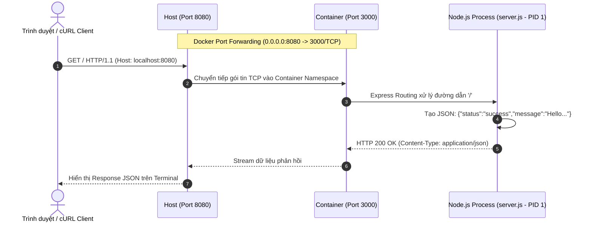

# Báo cáo Bài tập 2: Đóng gói ứng dụng Web Backend bằng Single-stage Dockerfile

- **Họ và tên:** Phạm Thanh Phong
- **Mã sinh viên:** N24DTCN120
- **Môn học:** IT209
- **Session:** 10
- **Bài tập:** 02 (BT2)
- **Tệp nộp bài:** [README.md](./README.md), [Dockerfile](./Dockerfile), [package.json](./package.json), [server.js](./server.js)
- **Đường dẫn trên GitHub:** `homework/session_10/ex2/`

---

## 1. Bối cảnh & Yêu cầu bài tập

### 1.1. Bối cảnh
Trong quy trình container hóa dịch vụ Backend (Node.js REST API), việc viết một `Dockerfile` chuẩn mực là yêu cầu cơ bản nhưng then chốt. Cần đảm bảo:
- Thời gian build nhanh nhất có thể bằng cách áp dụng **Docker Layer Caching**.
- Sử dụng các base image tối ưu dung lượng (như bản phân phối Alpine Linux).
- Đảm bảo tiến trình ứng dụng nhận diện và xử lý các tín hiệu hệ điều hành đúng chuẩn (Graceful shutdown) nhờ cú pháp **Exec Form**.

### 1.2. Ràng buộc thực thi
1. Viết ứng dụng Node.js/Express lắng nghe theo biến môi trường `PORT` (mặc định 3000), trả về payload JSON khi truy cập đường dẫn `/`.
2. Sử dụng base image `node:18-alpine`.
3. Khai báo đầy đủ các chỉ thị Dockerfile chuẩn: `FROM`, `WORKDIR`, `COPY`, `RUN`, `EXPOSE`, `ENV`, `CMD`.
4. Build image với định danh `hw-backend:v1` và khởi chạy container `app-single-stage` với ánh xạ cổng `8080:3000`.
5. Kiểm định phản hồi qua `curl -i http://localhost:8080/` và dọn dẹp container.

---

## 2. Kiến trúc Xây dựng Image & Luồng xử lý HTTP Request



---

## 3. Phân tích Kỹ thuật Dockerfile Best Practices

### 3.1. Tối ưu hóa Build Caching
Trong Dockerfile:
```dockerfile
COPY package*.json ./
RUN npm install
COPY . .
```
- Nếu gộp chung `COPY . .` trước `RUN npm install`, mỗi khi lập trình viên thay đổi dù chỉ một dòng comment trong mã nguồn `server.js`, Docker sẽ coi tầng đó đã bị thay đổi (cache invalidated) và buộc phải chạy lại toàn bộ `npm install` rất tốn thời gian và băng thông.
- Việc tách riêng `COPY package*.json` giúp Docker tái sử dụng cache của layer `npm install` nếu danh sách dependencies không có sự thay đổi.

### 3.2. Exec Form vs Shell Form của `CMD`
- **Exec Form (`CMD ["node", "server.js"]`):** Tiến trình `node` được khởi chạy trực tiếp với `PID 1` trong container. Khi Docker gửi lệnh `docker stop`, tín hiệu `SIGTERM` được gửi trực tiếp tới Node.js giúp ứng dụng đóng các kết nối an toàn (Graceful Shutdown).
- **Shell Form (`CMD node server.js`):** Docker sẽ bọc tiến trình trong subshell `/bin/sh -c "node server.js"`. Khi đó shell là PID 1 và thường không chuyển tiếp tín hiệu `SIGTERM` tới Node.js, dẫn đến việc container bị ép dừng thô bạo (`SIGKILL`) sau 10 giây.

---

## 4. Tóm tắt kết quả kiểm tra hệ thống

- **Image build:** `hw-backend:v1` (182MB trên nền Alpine).
- **Container status:** `Up` liên tục, lắng nghe tại `0.0.0.0:8080->3000/tcp`.
- **Phản hồi API:**
```json
{"status":"success","message":"Hello from Docker Single-stage!"}
```
- Toàn bộ log và mã nguồn đã được tổng hợp chi tiết tại tệp [README.md](./README.md).
